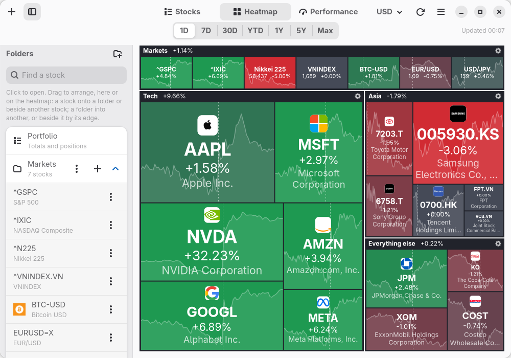
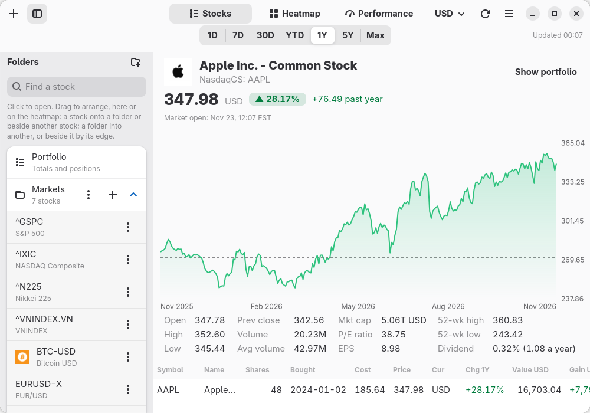
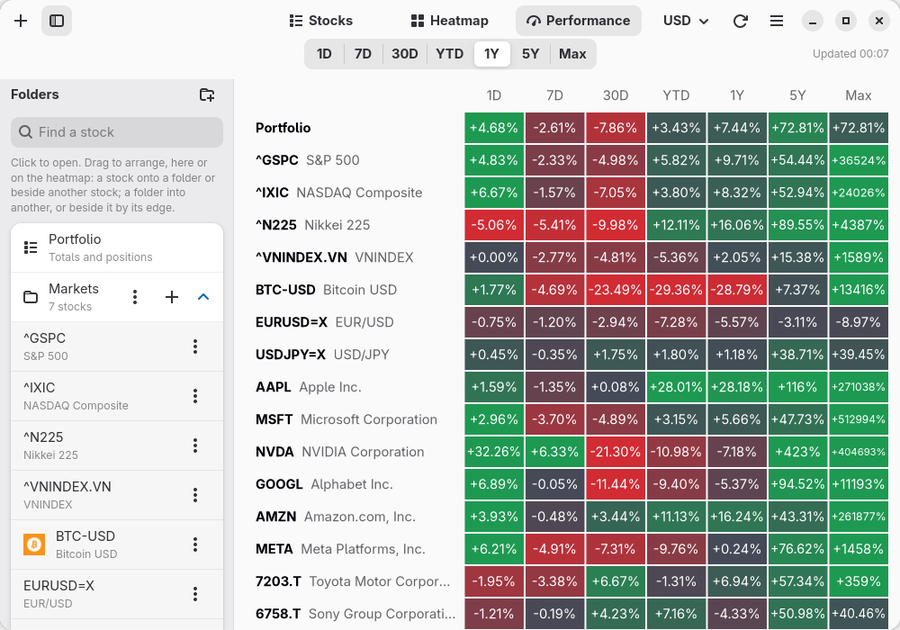

# Stonks

A GNOME app for following stocks and paper portfolios.



- Heatmap of everything you follow
- Charts from one day to a symbol's whole history
- Click a point on a chart for the figures as they stood then (P/E, market cap, the day's range); drag for from → to
- Live prices for the stock you have open
- Gains per holding and in total, in the currency you choose
- Holdings are optional: give a symbol a buy date and shares, or just watch it
- US, Tokyo, Korea, China, Hong Kong, Vietnam and more; indices, funds, currencies, crypto
- Uses publicly available APIs to pull data (and keeps a local cache to limit network chatter)

| One stock | Every range at once |
|---|---|
|  |  |

## Install

Download `stonks.flatpak` from the [latest release](https://github.com/Igneous/stonks/releases/latest), then:

```sh
flatpak install --user stonks.flatpak
```

Or build the Flatpak yourself:

```sh
flatpak install flathub org.gnome.Sdk//51 org.gnome.Platform//51 org.flatpak.Builder
flatpak run org.flatpak.Builder --user --install --force-clean build/flatpak io.github.igneous.Stonks.yml
```

Or natively, into `~/.local`. Needs `valac` and the development packages for GTK 4, libadwaita,
libsoup 3, json-glib and SQLite.

```sh
make check install
```

## Where the prices come from

Yahoo Finance for most things, SSI iBoard for Vietnam (Entrade for its hourly bars), CNBC for an index
Yahoo has no history for.
These are the keyless endpoints behind those sites' own charts, not official APIs: they can change
or stop, and prices can be delayed or wrong. Stonks is not affiliated with any of them, and nothing
here is investment advice.

Requests are kept few: a symbol's history is downloaded once, then only what is new, twenty symbols
to a request. See the top of [`src/feed.vala`](src/feed.vala).

## Licence

[MIT](LICENSE)
